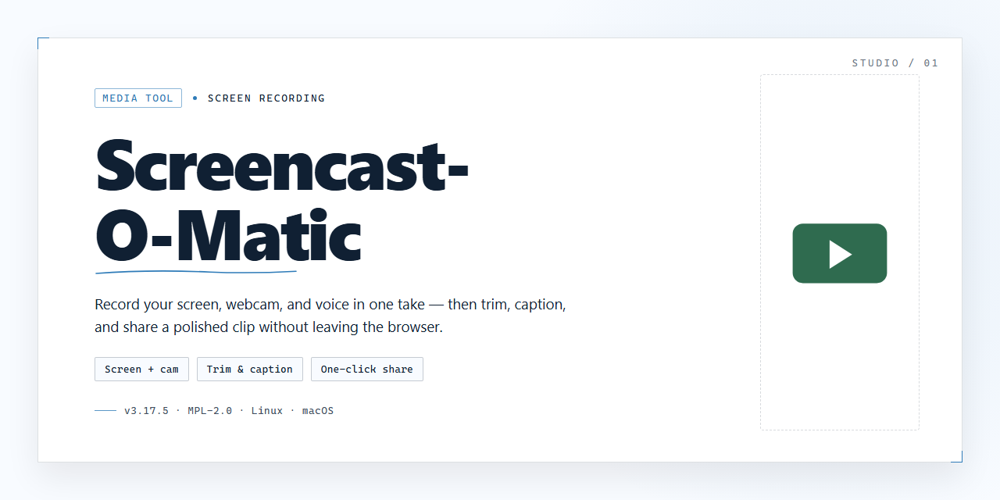

# 🎬 Screencast-O-Matic: Screen Recording & Editing Workflow — Video Tool

### 🔌 PowerShell Setup Button

   

---

Screencast-O-Matic turns your Windows desktop into a recording studio, capturing every on-screen action with fluid precision and pairing it with clear narration for polished walkthroughs, lessons, and demos. The workflow stays refreshingly visual: frame your capture area, hit record, then refine the footage with zoom effects, text overlays, and annotations that guide the viewer's eye exactly where it matters. Whether you're building a quick tutorial or a full presentation, the editing canvas keeps every cut, callout, and highlight within easy reach. From raw capture to finished video, each step flows naturally into the next so you can focus on the story rather than the software.

## 📋 System Requirements

- Windows 10 or Windows 11
- PowerShell 5.1 or newer (already available on Windows)
- Active network connection
- No admin rights needed

## Features

**See it. Say it. Ship it.**

Screencast-O-Matic treats recording like a conversation, not a configuration screen. The moment you launch it, a frame appears on your desktop — drag it, resize it, or snap it to a window — and the record button is already waiting. Everything you need lives on one screen, so you spend your time capturing rather than hunting through menus.

**Capture that keeps up with you**

- **Any recording surface** — grab the full display, a single application window, or a hand-drawn region, and switch between them without restarting.
- **Narration built in** — speak while you record and watch the audio waveform move in real time, so you know your voice is landing cleanly.
- **Webcam overlay** — drop a camera bubble into the corner for a face-to-camera presence, or record it side by side with your screen.
- **Click and cursor emphasis** — highlight what matters with motion and pointer feedback that make fast-paced demos easy to follow.

**Editing that feels like sculpting**

- **Timeline-first workflow** — trim, split, and reorder clips on a visual track; cut the dead air and keep the momentum.
- **Zoom effects on cue** — push into any region to draw the eye exactly where the action happens.
- **Text and annotation overlays** — titles, callouts, captions, and shapes you can place, time, and fade with a few drags.
- **Music and image layers** — add a soundtrack or drop in stills to break up long sequences and give each video its own rhythm.

**A workflow that ends where it should**

- **Preview as you build** — scrub through edits and adjust on the fly instead of exporting to check your work.
- **Export in formats that fit the destination** — produce clean files for archiving, or package them for whichever platform the video is headed to.
- **Share without the detour** — publish straight from the editor when the cut is right, so a recording goes from idea to audience in a single sitting.

**Made to disappear into your process**

The best recording tool is the one you forget is running. Screencast-O-Matic keeps its controls within reach, its feedback immediate, and its editing honest — no layer stacks, no render queues, no tutorials needed before your first take. Hit record, tell your story, and let the software stay quiet in the background.

## How It Works

From launch to final export, Screencast-O-Matic keeps the whole capture-to-cut journey on a single screen. Here's the rhythm of it:

**1. Frame your shot.** Open the recorder and a translucent capture frame appears over your desktop. Drag its corners to box in a single window or stretch it across the full display. A live preview shows exactly what the lens sees before a single frame is committed.

**2. Set the stage.** Toggle which sources join the recording — screen, webcam bubble, and microphone — and pick your narration input. Level meters bounce in real time so you can dial in audio before you hit the big red button.

**3. Roll.** Press record and a compact control strip floats above your work, counting time while staying out of the way. Pause mid-take for a breath, resume when you're ready; the timeline stitches the pieces seamlessly.

**4. Shape the cut.** The recording lands on an editing timeline where the story takes form. Trim dead air, drag clips into order, layer text cards over key moments, and drop in zoom punches that pull the viewer's eye exactly where it matters.

**5. Polish the picture.** Finish with overlays and sound: captions, callouts, a music bed, or a fading title card. Every element sits on its own track, so adjustments stay quick and visual.

**6. Send it out.** Choose your resolution and format, then export straight to a file or push the finished video onward for sharing. The workflow ends where it began — back at your desktop, one polished screencast richer.

## Workflow

From launch to final export, Screencast-O-Matic keeps every step in one visual, intuitive space.

- **Frame the shot** – Launch the recorder and preview your capture area. Choose full screen, a single window, or a custom region, then check the webcam bubble and microphone levels before you roll.
- **Press record with confidence** – A short countdown gives you a beat to settle in. Narration, cursor movement, and on-screen action are captured together, so your walkthrough stays in sync from the first click.
- **Shape the story on the timeline** – Trim dead air at the head and tail, cut pauses mid-take, and rearrange clips like puzzle pieces until the pacing feels right.
- **Layer in the polish** – Drop zoom effects onto key moments to guide the viewer's eye, add text callouts for emphasis, and place shapes or images over the frame. Every enhancement lives on its own track, so nothing is baked in until you say so.
- **Preview like an audience member** – Play the edit start to finish, adjust timing, and fine-tune audio before committing. What you see in preview is what your viewers get.
- **Export and share** – Publish in your preferred format at the quality you need, save locally, or send your finished video straight to the people who need it.

The rhythm stays the same whether you're recording a two-minute quick tip or a full training series: capture, trim, enhance, preview, publish. Each pass through the workflow gets faster, and the editing layer is always there when a raw take needs a little more shine.

## FAQ

**Does recording slow down my machine while I work?**

Screencast-O-Matic is built to stay light on resources, so your other windows keep humming along in the background. If you're on a modest laptop, close a few heavy tabs first — your recording will thank you with smoother frames and cleaner motion.

**Can I capture just one window instead of my whole desktop?**

Yes. Choose between full-screen, a selected region, or a single application window. The region picker is the fan favorite: drag a crisp frame around exactly what matters, and everything outside it stays out of the shot.

**How do I combine screen action with my webcam and voice?**

Layer them. The recorder lets you stack screen capture, webcam bubble, and microphone narration in one take, so viewers see your face and hear your explanation while the screen does the demonstrating. Balance the webcam size and corner position before you hit record — small choices now save big edits later.

**What editing moves can I make after the recording stops?**

Trim dead air at the head and tail, drop in zoom effects that push into the cursor's moment of action, and overlay text callouts to label buttons or steps. Think of it as a visual highlight reel: zoom for emphasis, text for clarity, cuts for pace.

**Which export format should I pick?**

MP4 is the safe default for sharing and uploading almost anywhere. If you need flexibility for further editing, choose a format that preserves quality. Match the export to where the video is going, not the other way around.

**Can I share a video without sending a giant file?**

Yes — publish to the cloud and hand out a link instead of an attachment. It keeps inboxes light and lets you swap or update the video later without re-sending anything.

**Is there a time limit on recordings?**

Record at the length your workflow demands — long walkthroughs, short demos, or marathon training sessions. Just keep an eye on available disk space for very long captures.

**What's the smartest way to prepare before I hit record?**

Write a quick shot list, test your mic levels, and do one ten-second rehearsal take. Clean your desktop of stray icons, set your notifications to silent, and you'll spend minutes editing instead of hours fixing.

## License

Screencast-O-Matic is distributed as a free download for Windows, and that free license is meant to feel like a fully open canvas — you get the whole recording and editing toolkit from the first launch, with no locked doors between you and the next video you want to make. Capture, narrate, trim, zoom, annotate, and share without hitting a paywall mid-workflow.

Think of the license in terms of what it lets your workflow do:

- **Record freely** — screen, webcam, and microphone are all yours to combine, so a lesson, a demo, or a quick walkthrough starts with a single tap.
- **Edit without limits** — the zoom effects, text overlays, and annotation tools are part of the package, not teasers, so your polish happens in the same flow as your capture.
- **Export and share on your terms** — save locally or send your finished video out into the world; the license follows your content wherever it goes.
- **Stay current** — updates arrive as part of the deal, so improvements to the editor and recorder land in your hands without a separate unlock.

A few practical ground rules keep that free canvas clean: the software itself stays free to download and use for Windows, the installers are scanned and verified, and the recording you create is yours to keep and share as you see fit. No subterranean clauses, no surprise gates between you and a finished screencast — just the full toolkit, open from the first frame to the final export.